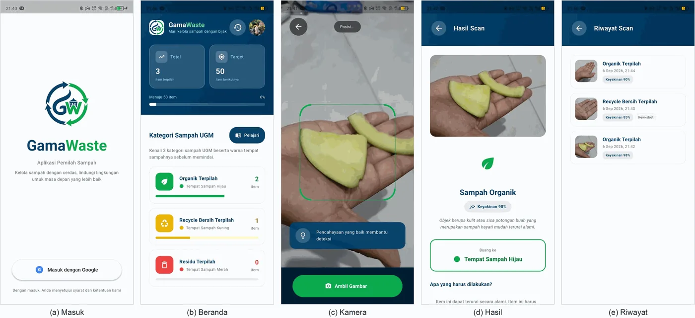
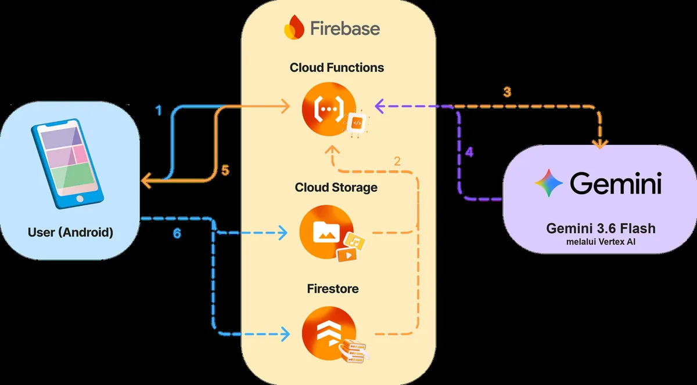
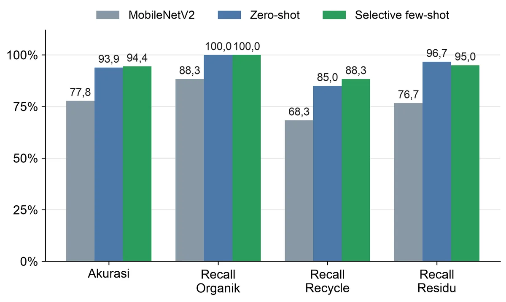

# GamaWaste (`gamaresik`)

[](https://github.com/khrlanamm/gamaresik/actions/workflows/ci.yml)


Flutter app for waste classification at Universitas Gadjah Mada. Users sign in with Google, scan a piece of waste with the camera, and get the category and the matching UGM bin color.

Classification runs on Google Gemini through Firebase Cloud Functions. The app never calls Gemini directly.

This is the app for my undergraduate thesis, *Pengembangan Aplikasi Mobile Klasifikasi Sampah Berbasis Generative AI dan Selective Few-Shot Learning* (Computer Science, UGM). Selective few-shot reached 94.4% accuracy, against 77.8% for a MobileNetV2 baseline. [Thesis at ETD UGM](https://etd.repository.ugm.ac.id/penelitian/detail/286836)

## Screenshots



## Architecture



1. The app uploads the photo to `scans/{uid}/` in Cloud Storage and calls `classifyWaste` with its path.
2. The function reads the mode from `app_config/settings` and, when needed, validated examples from `few_shot_data`.
3. Gemini classifies the photo through Vertex AI with the function's own credentials.
4. The function logs the result under `users/{uid}/classifications` and returns it to the app.

## Results



Accuracy and recall per category (organic, recyclable, residual) on the thesis test set. Selective few-shot reached the highest accuracy (94.4%) and the best recall for recyclables.

## Waste categories

| Category | Bin |
| --- | --- |
| Organik Terpilah (sorted organic) | Green |
| Recycle Bersih Terpilah (clean recyclables) | Yellow |
| Residu Terpilah (residual) | Red |

## Classification modes

The mode is set in Firestore (`app_config/settings`) without a new build:

- **`zero-shot`**: one inference with no examples.
- **`few-shot`**: inference with validated examples from the `few_shot_data` collection.
- **`selective`**: always zero-shot first. If `confidence_score` is below `confidence_threshold`, the function fetches `few_shot_count` validated examples and classifies again (re-inference).

User corrections through the **"Laporan Hasil Tidak Tepat"** (report wrong result) button are saved as validated examples, so few-shot accuracy improves with use.

## Running

```bash
flutter pub get
flutter run
```

Backend (needs access to the Firebase project `gamaresik`):

```bash
cd functions && npm install
firebase deploy --only functions,firestore,storage
```

## Tests

```bash
flutter analyze          # static analysis
flutter test             # unit and widget tests
cd functions && npm test # zero-shot, few-shot, and selective logic (offline)
```

## Configuration and credentials

Classification runs on **Vertex AI** with the Cloud Function's own Application Default Credentials. There is no API key to store, rotate, or leak.

> **Never** add `.env` or any credential file to `assets:` in `pubspec.yaml`. Everything under `assets:` is packed into the APK or IPA and is easy to extract.

Vertex AI is billed to the project's Blaze billing account. Keep `aiplatform.googleapis.com` enabled.

### Android release build

Release signing reads `android/key.properties`, which points to `android/gamaresik-release.jks`. Both are gitignored and **not in the repo**. Without them, `flutter build apk --release` falls back to the debug key and prints a warning.

```bash
flutter build apk --release
```

The SHA-1 and SHA-256 of the release certificate must be registered in the Firebase Console (Project Settings, Android app). Otherwise Google Sign-In fails with `ApiException: 10` even though the build succeeds.

Architecture notes are in [CLAUDE.md](CLAUDE.md).

## License

Code is released under the [MIT License](LICENSE). The GamaWaste name and logo (`assets/brands/`, `design/`) are not covered.
